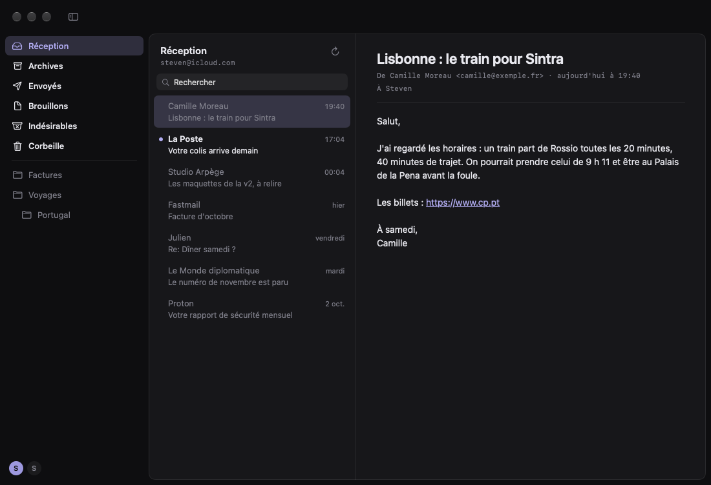
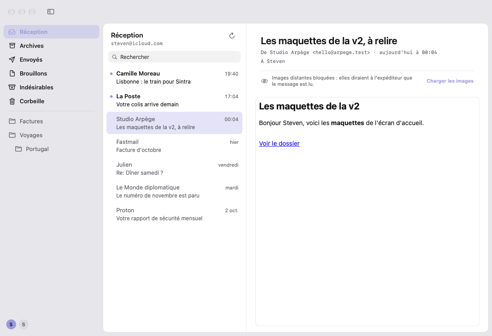
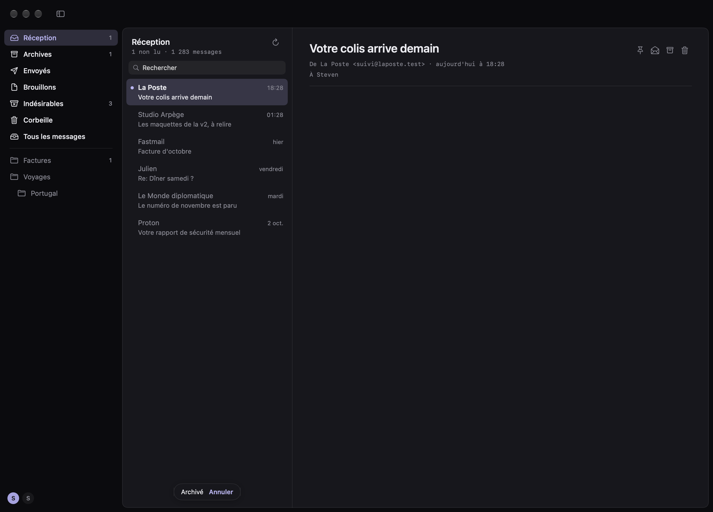
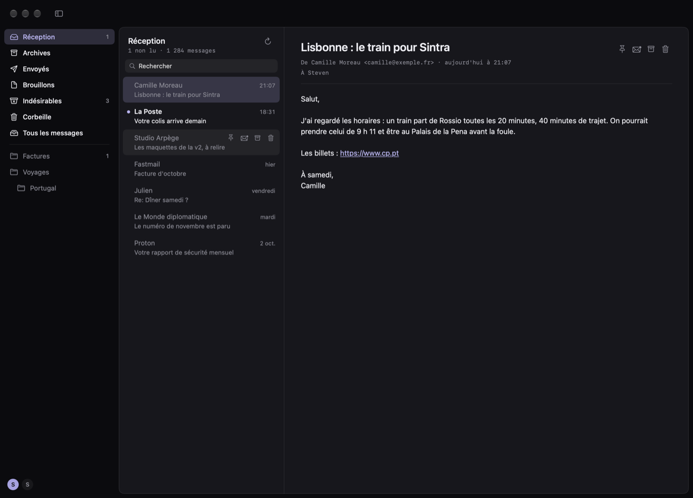
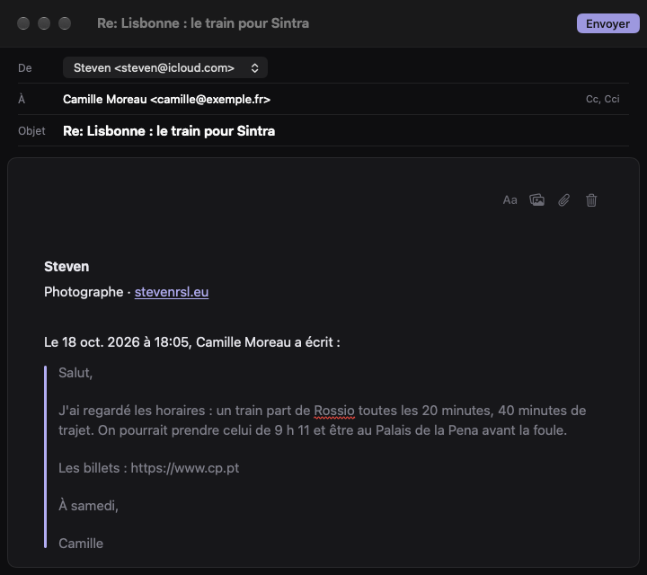
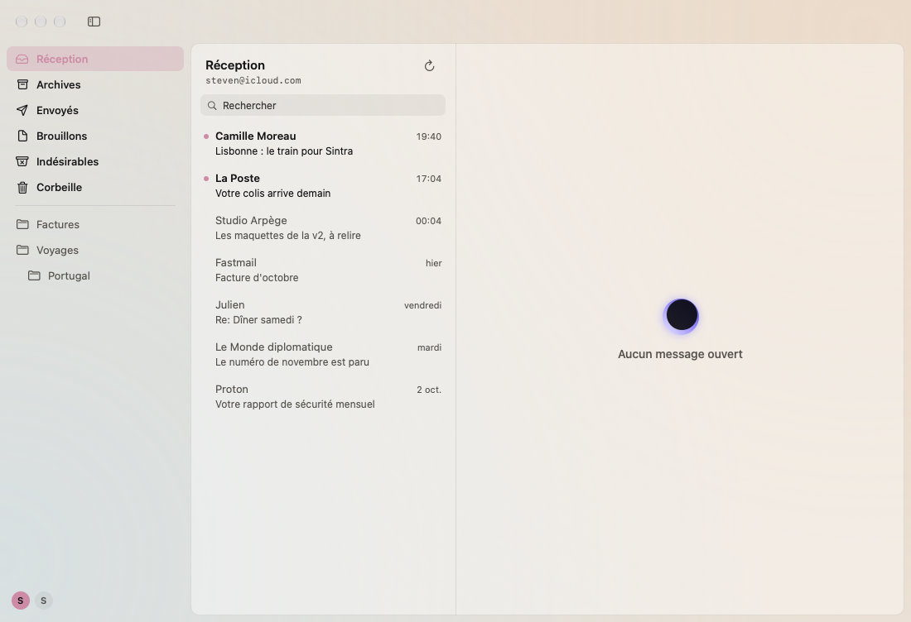
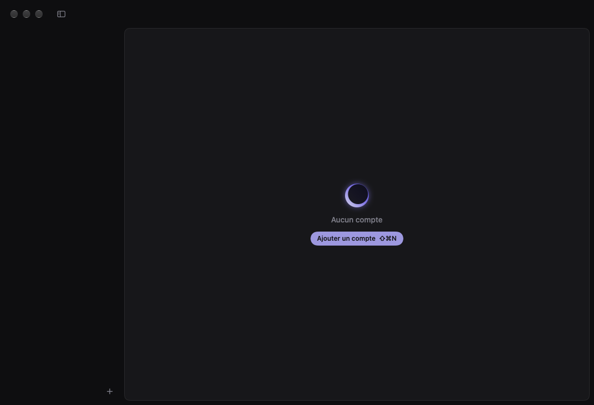
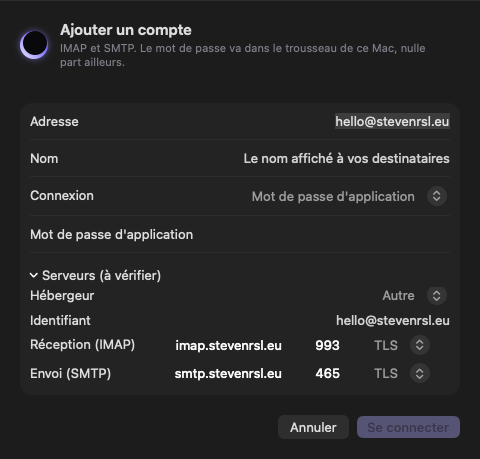
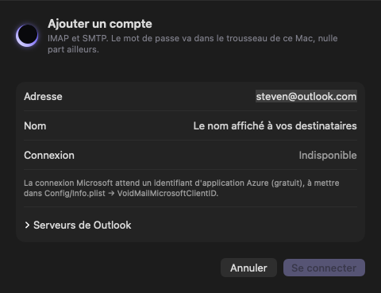

# Void Mail

**Un courrier qui s'efface derrière le message.** Version **0.0.5** (préversion : lire, trier, écrire). Void Mail est le troisième compagnon de Void et de [Void Notes](../Void%20Notes) : même palette, même chrome sombre, mêmes réglages d'apparence, rien de superflu à l'écran. Le projet et ses choix sont décrits dans [CONCEPT.md](CONCEPT.md).

- Swift + SwiftUI, AppKit là où c'est utile (fenêtre, barre de titre)
- Mac : Apple silicon, macOS 14 minimum. iPhone : plus tard, sur `Shared/`
- **≈ 2,5 Mo** (build Release), aucune dépendance externe (Foundation, Security, CryptoKit, AuthenticationServices, WebKit, SQLite du système)
- Aucun compte Void, aucun serveur intermédiaire : l'app parle directement aux serveurs IMAP et SMTP de l'hébergeur







| | |
|---|---|
|  |  |

| | |
|---|---|
|  |  |
|  |  |

## Compiler et lancer

Prérequis : Xcode 16 ou plus récent (projet au format « dossiers synchronisés », comme Void et Void Notes ; testé avec Xcode 27), un Mac Apple silicon.

**Avec Xcode** : ouvrir `VoidMail.xcodeproj`, choisir le schéma *VoidMail* → *My Mac*, puis ⌘R. Comme dans Void Notes, une post-action du schéma copie l'app compilée dans `/Applications` (compte rendu dans `build/copy-to-applications.log`).

**En ligne de commande** :

```bash
xcodebuild -project VoidMail.xcodeproj -target VoidMail -configuration Release SYMROOT="$PWD/build/DerivedData/Build/Products" OBJROOT="$PWD/build/DerivedData/Build/Intermediates.noindex" build
```

```bash
./scripts/install.sh
```

```bash
./scripts/make-dmg.sh
```

**Signature** : certificat *Apple Development* de l'équipe `5Q6B9P9723`, comme Void et pas en ad hoc comme Void Notes. macOS reconnaît ainsi l'app d'un build à l'autre et ne redemande pas le mot de passe de session pour les éléments du trousseau. L'app est sandboxée, avec une seule autorisation : les connexions réseau sortantes.

L'icône est générée par script (`swift scripts/make-icon.swift`) : une enveloppe sur la nuit de Void, scellée par son éclipse.

## Comptes

Réglages (⌘,) → Comptes, ou ⌥⌘N, ou le « + » en bas de la barre latérale. On tape l'adresse, l'app en déduit les serveurs (table locale : rien ne quitte le Mac pour les trouver). « Se connecter » joint les deux serveurs, se connecte et liste les boîtes **avant** de garder quoi que ce soit ; une étape qui échoue dit pourquoi, en clair.

| Hébergeur | Connexion | Serveurs |
|---|---|---|
| iCloud (`icloud.com`, `me.com`, `mac.com`) | mot de passe pour app | `imap.mail.me.com:993` TLS · `smtp.mail.me.com:587` STARTTLS |
| Gmail | mot de passe d'application (validation en deux étapes) | `imap.gmail.com:993` · `smtp.gmail.com:465` TLS |
| Outlook.com, Hotmail, Live | **OAuth Microsoft uniquement** | `outlook.office365.com:993` · `smtp.office365.com:587` STARTTLS |
| Fastmail | mot de passe d'application | `imap.fastmail.com:993` · `smtp.fastmail.com:465` TLS |
| Proton (`proton.me`…) | mot de passe de **Proton Mail Bridge** | `127.0.0.1:1143` · `127.0.0.1:1025` STARTTLS |
| Autre domaine | au choix | `imap.<domaine>:993` · `smtp.<domaine>:465`, à vérifier ; « Hébergeur » propose Proton, iCloud, Fastmail ou Microsoft 365 pour une adresse sur son propre domaine |

- **Secrets** : le mot de passe ou les jetons OAuth vont dans le trousseau de session (service `app.void.mail`), jamais dans les fichiers ni les préférences. Retirer un compte les retire.
- **Chiffrement** : TLS dès le premier octet, ou STARTTLS. Une connexion en clair n'est permise que vers ce Mac. Le certificat auto-signé de Proton Mail Bridge n'est accepté que pour `127.0.0.1` / `localhost`.
- **OAuth Microsoft, prêt à brancher** : PKCE dans la feuille de connexion de macOS (`ASWebAuthenticationSession`, session éphémère), SASL `XOAUTH2`, jeton rafraîchi une minute avant son expiration. Pour l'activer, enregistrer une application sur le portail Azure (gratuit, sans audit) :
  1. *App registrations* → *New registration*, comptes « Any Entra ID tenant + personal Microsoft accounts » ;
  2. *Authentication* → *Mobile and desktop applications*, URI de redirection `voidmail://oauth` ;
  3. *API permissions* → Office 365 Exchange Online (ou Microsoft Graph) : `IMAP.AccessAsUser.All`, `SMTP.Send`, `offline_access` ;
  4. copier l'*Application (client) ID* dans `Config/Info.plist` → `VoidMailMicrosoftClientID`.

  Tant qu'il est vide, la connexion Microsoft s'affiche grisée, avec cette raison. Google suit le même code (`VoidMailGoogleClientID`), volontairement vide : voir CONCEPT.md.

**Où sont les comptes** : `~/Library/Containers/app.void.mail/Data/Library/Application Support/Void Mail/accounts.json` (adresse, serveurs, mode de connexion, boîtes trouvées). Un fichier illisible n'est jamais écrasé : il est mis de côté (`accounts.unreadable-….json`) et la fenêtre le dit.

## La fenêtre

La mise en page de Void Notes, avec une colonne de plus :
- les boîtes sur le cadre : Réception, Archives, Envoyés, Brouillons, Indésirables, Corbeille, Tous les messages (reconnues par leurs attributs SPECIAL-USE, ou par leur nom sur les serveurs qui n'en ont pas), un trait, puis les autres dossiers du serveur en gris, en retrait selon leur profondeur, avec leurs noms accentués décodés (UTF-7 modifié) ; « Folders » et « Labels » de Proton Mail Bridge deviennent « Dossiers » et « Libellés » ;
- les messages et le message, sur la feuille posée sur le cadre (voir « Lire ») ;
- les comptes en bas de la barre latérale, comme les espaces de Void Notes (⌃⌘← / ⌃⌘→ pour passer de l'un à l'autre).

Réglages → Apparence : thème, couleur d'accent et teinte de la fenêtre, **le même code et les mêmes clés** que Void et Void Notes (`Shared/App/Theme.swift`, `ChromeTint.swift`).

## Lire

- **Compteurs** : les non lus à droite de chaque boîte (pas pour Envoyés, Brouillons, Corbeille ni « Tous les messages »), et sous le nom de la boîte ouverte « 12 non lus · 1 284 messages » — les chiffres du serveur (STATUS), relus à chaque relève ; lire un message les met à jour aussitôt.
- **La liste** : expéditeur et date (« 15:41 », « hier », « vendredi », « 2 oct. »), objet ; non lu en clair avec un point d'accent, lu en gris. ↑ ↓ ou J K pour passer d'un message à l'autre, U (ou ⇧⌘U) pour lu / non lu, ⇧⌘N pour relever.
- **Relève** : à l'ouverture d'une boîte, au retour dans l'app et par ⇧⌘N. La première visite d'une boîte rapporte ses **300 derniers messages** ; ensuite seuls les nouveaux, les drapeaux des autres, et ce qui a disparu du serveur est retiré. Une connexion IMAP par compte, gardée ouverte, rouverte une fois si elle est tombée.
- **Le message** : l'objet en titre, la ligne de l'expéditeur et de la date en petite chasse fixe, comme les dates d'une note. Ouvrir un message le marque lu, sur le serveur aussi. Un texte brut prend la typographie de l'app, ses adresses deviennent des liens ; un message HTML garde sa page blanche, sur une carte, **sans JavaScript, sans cookies, sans rien charger d'Internet** (une politique de sécurité de contenu passe devant celle du message). « Charger les images » les autorise pour ce message. Les images intégrées (`cid:`) s'affichent toujours. Un lien s'ouvre dans le navigateur.
- **Pièces jointes** : en cartes (icône, nom, taille) sous l'en-tête ; un clic en ouvre une copie dans son app.
- **Recherche** : dans toutes les boîtes du compte, sur l'objet, l'expéditeur et le texte des messages déjà ouverts, au début des mots, accents ignorés (FTS5).
- **Cache** : `mail.sqlite` à côté de `accounts.json` : enveloppes des boîtes visitées, messages ouverts, index de recherche. Le serveur reste la vérité : si la boîte est renumérotée (UIDVALIDITY), ce que le cache en savait est oublié. Retirer un compte retire aussi son cache.
- **Décodage** : MIME complet (parties imbriquées, quoted-printable, base64, jeux de caractères, mots encodés RFC 2047, noms de fichier RFC 2231), réponses IMAP lues en octets bruts, littéraux compris.

## Trier

Un geste par message, au clavier dans la liste, par les boutons au bout de la ligne de l'objet (comme ceux d'une note), ou — comme dans Spark — par les **petites icônes qui remplacent la date au survol d'une ligne** (épingler, lu / non lu, archiver, corbeille), sans ouvrir le message. Clic droit sur une ligne : les mêmes, et **« Déplacer vers »** n'importe quelle boîte du compte.

| Geste | Clavier | Ce qui se passe |
|---|---|---|
| Archiver | E (⌃⌘A, comme dans Void Notes) | vers la boîte Archives ; depuis les Archives, retour en Réception |
| Mettre à la corbeille | ⌫ (⌘⌫) | vers la Corbeille ; depuis la Corbeille, suppression définitive après confirmation |
| Épingler en tête | ⌃⌘P | drapeau `\Flagged` du serveur : le message passe en tête de sa boîte, suivi d'une épingle |
| Lu / non lu | U (⇧⌘U) | |

- **Annuler** : le message quitte la liste aussitôt, le suivant s'ouvre, les compteurs suivent ; « Archivé · Annuler » reste **5 secondes** en bas de la liste (⌘Z aussi). Le geste ne part au serveur qu'ensuite — ou tout de suite si un autre geste suit, ou si l'on quitte l'app. Refusé par le serveur, le message revient à sa place et l'erreur le dit.
- **Sur le serveur** : `UID MOVE` (RFC 6851) quand il le connaît, sinon copie, `\Deleted` et `UID EXPUNGE` (seulement ces messages, avec UIDPLUS).
- **Nouveaux messages en direct** : une seconde connexion par compte attend en **IDLE** sur la Réception (relancée toutes les 24 minutes, sous la limite des serveurs) ; ce qui y arrive ou en part met la liste et les compteurs à jour sans ⌘R. Sans IDLE sur le serveur, la Réception est relue toutes les 5 minutes. Après une coupure (veille, réseau), la connexion revient d'elle-même, en espaçant ses essais.
- ⌘Z sert à annuler un geste ou un envoi : le menu Édition n'a plus son « Annuler » pour le texte des champs (la recherche, les adresses) ; dans le texte d'un message, l'éditeur garde le sien.

## Écrire

⌘N (ou le crayon en haut à droite) pour un nouveau message ; ⌘R répondre, ⇧⌘R répondre à tous, ⇧⌘F transférer (aussi R et A dans la liste, et les flèches au bout de la ligne de l'objet). Chaque message s'écrit dans sa propre fenêtre, sur le cadre de Void.

- **L'éditeur de Void Notes**, repris tel quel (`Shared/Editor`, `VoidMail/Editor`) : on tape `# `, `- `, `1. `, `[] `, `> `, `**gras**`, `*italique*`, `==surligné==`, `~~barré~~`, `` `code` ``, `---`, les marques disparaissent et le texte prend sa forme ; listes imbriquées (Tab), Markdown collé mis en forme, orthographe soulignée. Au bout de la première ligne, **les mêmes boutons que dans une note** : **Aa** ouvre le panneau de mise en forme de Void Notes (style, gras, italique, barré, code, surlignage, graisse, listes, retrait, citation, séparateur, lien), puis les images (photothèque ou fichier, dans le texte), le trombone et la corbeille qui jette le brouillon ; une fois le texte défilé, ils restent en haut, sur un fond à eux, et s'effacent pendant la frappe. Menu **Format** avec les raccourcis de Void Notes (⌘B, ⌘I, ⇧⌘E surligner, ⇧⌘X barré, ⌥⌘1 / 2 / 0, ⌥⌘6 / 7 / 8 listes, ⌥⌘9 citation, ⌘K lien, ⇧⌘A joindre). Pas de titre automatique sur la première ligne, pas de date : c'est un message.
- **Adresses** : séparées par des virgules ; ceux qui ont déjà écrit au compte sont proposés pendant la frappe, juste sous le champ (↑ ↓, Tab ou Entrée ; Échap les range). Cc et Cci à la demande. Un destinataire manquant ou une adresse qui n'en est pas une est signalé avant l'envoi.
- **Pièces jointes** : le trombone (⇧⌘A), le bouton des images, glisser-déposer ou coller dans le texte, en cartes comme dans une note. Un message transféré emporte les siennes (✕ pour en retirer une).
- **Répondre** : « Re: » (jamais « Re: Re: »), le texte d'origine en citation sous « Le 18 oct. 2026 à 18:05, Camille a écrit : », le curseur au-dessus ; répondre à tous écarte sa propre adresse ; le fil est gardé (`In-Reply-To`, `References`).
- **Ce qui part** : `multipart/alternative` — une version texte en Markdown, lisible telle quelle, et un HTML sobre (titres, listes, citations, gras…, aucune police ni couleur imposée) —, les fichiers en `multipart/mixed`, objet et noms encodés (RFC 2047), quoted-printable à 76 colonnes, CRLF. Les Cci sont dans l'enveloppe SMTP, jamais dans les en-têtes.
- **Envoi différé** : « Envoyer » (⌘↩) ferme la fenêtre ; le message part **10 secondes** plus tard — « Envoi de « … » · Annuler » en bas de la liste, ou ⌘Z, le rouvre. Quitter l'app l'envoie d'abord. S'il échoue, il revient dans sa fenêtre, rien n'est perdu.
- **Envoyés** : après l'envoi, Void Mail cherche le message dans Envoyés par son `Message-ID` (2, puis 4, puis 6 secondes plus tard) ; les serveurs qui y rangent eux-mêmes une copie (Gmail, Microsoft) n'en ont donc pas deux, et chez les autres — Proton Mail Bridge compris, vérifié — la copie est déposée par IMAP `APPEND`.
- **Brouillons** : fermer la fenêtre sans envoyer range le message dans Brouillons (pas de bouton « Enregistrer ») ; la corbeille au bout de la première ligne le jette. Un message laissé vide est simplement oublié.
- **Signature** : une par compte, Réglages → Comptes, écrite en Markdown (`**gras**`, `[lien](https://…)`). Elle s'ajoute sous un nouveau message, et sous la ligne de réponse d'une réponse ou d'un transfert, au-dessus de la citation ; le curseur attend au-dessus d'elle. Changer d'expéditeur dans la fenêtre ne change pas (encore) la signature déjà en place.
- **Reprendre un brouillon** : un message de Brouillons s'ouvre avec « Continuer » à la place des réponses (aussi ↩ dans la liste, ou ⌘R) : il revient dans une fenêtre d'écriture avec ses destinataires, ses Cci, son objet, son fil, ses fichiers et **sa mise en forme** (sa version texte est le Markdown qu'il a été enregistré). Enregistré de nouveau ou envoyé, il remplace l'ancien dans Brouillons.
- **`mailto:`** : Void Mail ouvre les liens `mailto:` (destinataire, objet, texte, Cc) dans un nouveau message.

## État (honnête)

✅ terminé et vérifié par l'auto-test · ☑️ terminé, vérifié à la compilation et sur capture, pas par un test automatisé · 🟡 partiel · ❌ pas encore.

- ✅ SASL `PLAIN` et `XOAUTH2`
- ✅ Réponses IMAP : `LIST` (guillemets, atomes, `NIL`, échappements, littéraux), capacités, noms en UTF-7 modifié (décodage et encodage)
- ✅ Rôle et ordre des boîtes, avec ou sans SPECIAL-USE
- ✅ Annuaire des hébergeurs, hébergeurs pour un domaine perso, ports usuels
- ✅ Refus des connexions en clair hors de ce Mac
- ✅ Comptes enregistrés sans aucun secret ; trousseau (en mémoire pendant le test)
- ✅ **Connexions réelles, sans identifiants** (`-network YES`) : IMAP en TLS (Gmail), IMAP passé en STARTTLS (Microsoft), SMTP passé en STARTTLS (iCloud), mauvais mot de passe refusé avec un message clair
- ☑️ Feuille d'ajout de compte, barre latérale, barre des comptes, réglages, apparence (captures ci-dessus)
- ✅ Réponses FETCH (enveloppes, littéraux, drapeaux), MIME (parties imbriquées, quoted-printable Latin-1, images `cid:`, pièces jointes base64, pixel espion repéré), dates de la liste, politique HTML, cache et recherche (ordre, accents, mots partiels, retrait, UIDVALIDITY)
- ☑️ **Connexion complète d'un vrai compte** : vérifiée à la main avec un compte Proton (domaine perso, via Bridge) — boîtes listées, SMTP authentifié
- ☑️ Liste des messages, message texte et HTML, bandeau des images, pièces jointes (captures ci-dessus, comptes de démonstration)
- ☑️ **Relève sur un vrai compte** : vérifiée à la main sur le compte Proton (Réception, dossiers imbriqués)
- 🟡 **OAuth Microsoft** : écrit, jamais exécuté de bout en bout (pas d'identifiant Azure, pas de compte Outlook)
- ☑️ Archiver, corbeille, épingler, annuler (captures en démonstration) ; 🟡 pas encore essayés sur un vrai compte
- 🟡 IDLE : écrit, pas encore observé sur un vrai compte
- ✅ Écrire : message composé puis relu par le décodeur (objet accentué, destinataires, Cci absent des en-têtes, Markdown, HTML, pièce jointe au nom accentué, CRLF), quoted-printable, réponse (destinataires, « Re: », fil, citation), répondre à tous, transfert, adresses vérifiées, `mailto:`
- ☑️ Fenêtre d'écriture, actions au survol (captures en démonstration)
- ☑️ **Envoi réel (SMTP)** : vérifié à la main avec le compte Proton (via Bridge), le 18 oct. 2026
- 🟡 Copie dans Envoyés (recherche puis `APPEND`), brouillon rangé à la fermeture : pas encore vérifiés sur un vrai compte
- ❌ Messages plus anciens que les 300 derniers, lecture épurée, gestes sur plusieurs messages à la fois
- ❌ Ponts avec Void et Void Notes (« Envoyer vers Void Notes », « Envoyer la page par mail »)
- ❌ iPhone

## Vérifier

```bash
"build/DerivedData/Build/Products/Debug/Void Mail.app/Contents/MacOS/Void Mail" -selfTest YES
```

125 vérifications avec `-network YES` (121 sans). Le code de sortie est le nombre d'échecs. Le test ne touche ni aux vrais comptes, ni aux préférences, ni au trousseau.

Autres arguments (builds Debug) : `-demo YES` (deux comptes de démonstration et leur Réception ; `-openUID 101` ou `103` ouvre un message texte ou HTML, `-gesture archive`, `trash` ou `pin` y applique un geste, `-hoverUID 103` montre les actions au survol, `-compose reply` ou `new` ouvre une fenêtre d'écriture, `-closeCompose YES` la ferme et dit si l'app a tenu, `-composeTo l` y tape « l » dans le champ À pour montrer les suggestions, `-showFormat YES` y ouvre le panneau Aa, `-mailbox Drafts -openUID 501` montre un brouillon et `-compose continue` le reprend), `-addAccount YES -address <adresse>` (la feuille ouverte), `-theme light -accent pink -tint peach` (l'apparence), `-snapshot YES` (une capture de la fenêtre, ou de la feuille ouverte, en PNG base64 sur la sortie standard, la seule sortie que le bac à sable laisse lire) :

```bash
"build/DerivedData/Build/Products/Debug/Void Mail.app/Contents/MacOS/Void Mail" -demo YES -snapshot YES | sed -n 's/^SNAPSHOT://p' | base64 -d > fenetre.png
```

## Organisation du code

| Dossier | Contenu |
|---|---|
| `Shared/App` | Préférences (`AppSettings`), palette (`Theme`), teinte de la fenêtre (`ChromeTint`) : repris de Void Notes |
| `Shared/Mail` | Compte, serveur, boîte (`MailAccount`), hébergeurs (`ProviderDirectory`), trousseau (`Keychain`), OAuth (`OAuth`), connexion ligne à ligne et SASL (`MailStream`), `IMAPClient` et ses réponses (`IMAPValue`), `SMTPClient`, MIME (`MIME`), cache et recherche (`MailCache`), connexion par compte et relève (`AccountSession`), comptes sur disque et vérification d'un compte (`AccountStore`), état de la fenêtre (`MailModel`), dates (`MailDate`), message écrit et sa mise en MIME (`OutgoingMessage`), envoi différé et brouillons (`Outbox`) |
| `Shared/Editor` | L'éditeur de Void Notes : format (`NoteFormat`, `NoteContent`), règles de frappe (`TypingRules`), Markdown (`NoteMarkdown`), HTML envoyé (`NoteHTML`) |
| `Shared/Debug` | Arguments de lancement et comptes de démonstration (builds Debug) |
| `VoidMail/App` | Mac : point d'entrée, menus |
| `VoidMail/UI` | Mac : fenêtre, barre latérale et comptes (`MailboxSidebar`), liste (`MessageList`), message et HTML protégé (`MessageView`), écrire (`ComposeView`), ajout d'un compte (`AccountSheet`), cadre de la fenêtre (`AppKitBridges`) |
| `VoidMail/Editor` | Mac : la vue de texte de Void Notes (`NoteTextView`), pièces jointes, orthographe |
| `VoidMail/Settings` | Mac : réglages |
| `VoidMail/Debug` | Mac : auto-test (builds Debug uniquement) |
